# Least Privilege in IAM: A Read-Only S3 Policy, Roles and a Permissions Boundary

> **Status:** Complete (Week 2).
> **Date:** 2026-11-14 · **Environment:** personal AWS account (Free plan), us-east-1

## Why this matters

Granting only the permissions needed to perform a task follows the principle of least privilege. It reduces security risks by preventing unauthorized access, accidental changes and unnecessary exposure of sensitive data. If an identity is compromised, limited permissions also minimize the potential damage an attacker can cause. 

## The policy I wrote

Policy: [`policies/week-02/s3-readonly-lab-bucket.json`](policies/week-02/s3-readonly-lab-bucket.json)

AWS treats the bucket and its individual objects as different resources. ListBucket works on the bucket itself. GetObject works on files inside the bucket. Two statements let us specify the correct resource ARN for each action. It makes the policy easier to read, understand, troubleshoot, audit and modify independently.

During testing, `aws s3 ls` didn't work because it requires the `s3:ListAllMyBuckets` permission to list all my account's buckets. However, `aws s3 ls s3://$BUCKET` works because it lists the contents of the specific bucket that my policy allows.

Keep in mind that AWS-managed `AmazonS3ReadOnlyAccess` grants much broader read-only access across S3 resources, rather than limiting access to my one lab bucket.

For example, AWS-managed `AmazonS3ReadOnlyAccess` can allow listing buckets across the account and reading objects in other buckets, where no other restrictions block that access. It also grants additional S3 read/list-related actions.

For this lab, it's better to create a policy that only grants two actions on one bucket. It follows least privilege, reducing unnecessary access.

## Testing it: simulator vs real calls

| Action                        | Simulator | Real CLI call |
| ----------------------------- | --------- | ------------- |
| `s3:ListBucket` (lab bucket)  | Allowed   | Works         |
| `s3:GetObject` (lab bucket)   | Allowed   | Works         |
| `s3:PutObject`                | Denied    | Denied        |
| `s3:DeleteObject`             | Denied    | Denied        |
| `s3:ListAllMyBuckets`         | Denied    | Denied        |

```
upload failed: ./write.txt to s3://denys-iam-lab-1234/write.txt An error occurred (AccessDenied) when calling the PutObject operation: User: arn:aws:sts::123456789012:assumed-role/s3-readonly-test-role/botocore-session-1794696244 is not authorized to perform: s3:PutObject on resource: "arn:aws:s3:::denys-iam-lab-1234/write.txt" because no identity-based policy allows the s3:PutObject action
```

This `AccessDenied` error confirms that my assumed IAM role does not have the `s3:PutObject` permission required to upload files to the S3 bucket. This is an example of an implicit deny because no identity-based policy explicitly allows the action. Unlike an implicit deny, an explicit deny specifically prohibits an action and overrides any applicable Allow. This test demonstrates that my least-privilege policy is working as intended.

## Roles and trust policies

### IAM Roles, Trust Policies, and Instance Profiles

**Trust Policy vs. Permissions Policy**

A trust policy defines who is allowed to assume an IAM role, while a permissions policy defines what actions can be performed after assuming that role. The trust policy controls access to the role, and the permissions policy controls access to AWS resources.

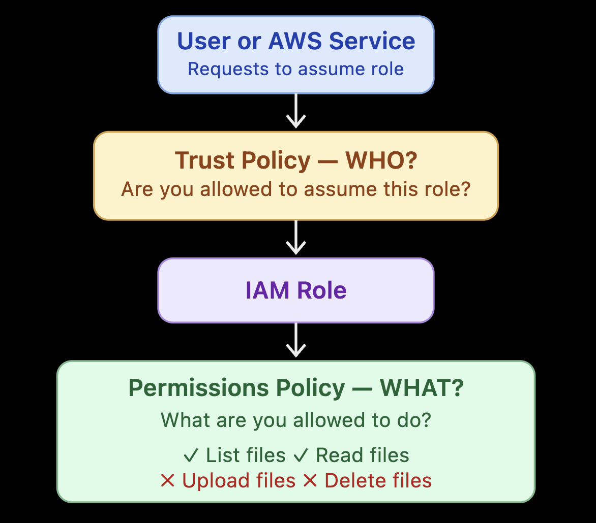

**Comparing Trust Policies**

The `trust-denys-admin.json` policy trusts a specific IAM user, `denys-admin`, while the `trust-ec2.json` policy trusts the EC2 service through `ec2.amazonaws.com`. Both policies use `sts:AssumeRole`, but they have different trusted principals. Both roles have the same S3 read-only permissions policy attached, demonstrating that the same permissions policy can be reused across different roles.

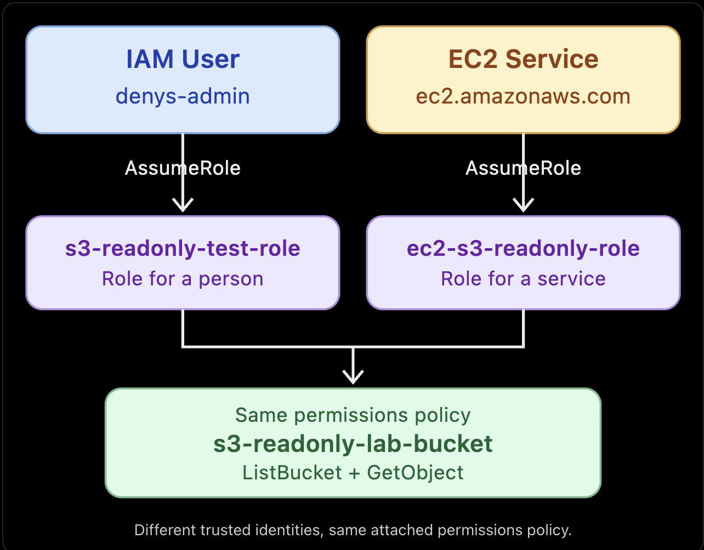

**Instance Profile**

An instance profile is a container that connects an IAM role to an EC2 instance, allowing applications to obtain temporary AWS credentials without storing permanent access keys.

The AWS Management Console automatically creates an instance profile when creating an EC2 role. The AWS CLI does not create one automatically because IAM roles and instance profiles are separate resources, and not every role requires an instance profile. When using the CLI, the instance profile must be created separately, and the IAM role must be added to it.

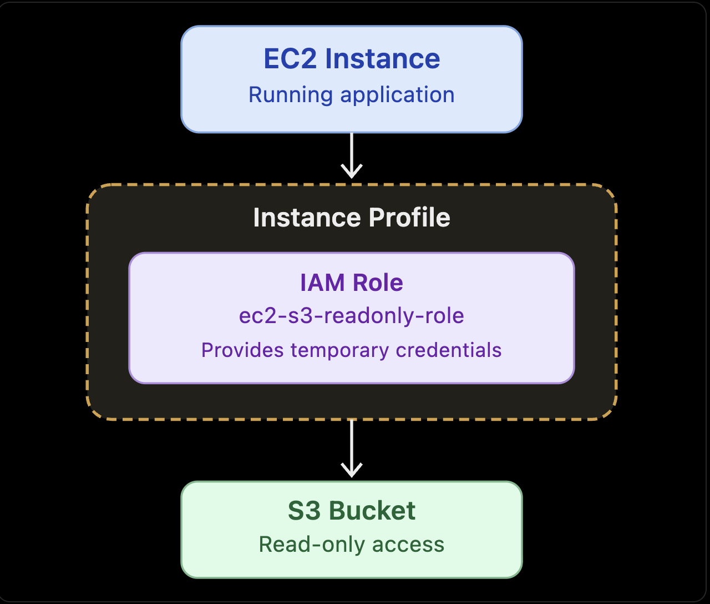

## Permissions boundaries

After applying the permissions boundary in Step 7, `s3:GetObject` was denied even though the original permissions policy allowed it. This happened because effective identity-based permissions are the intersection of the permissions policy and the permissions boundary (policy ∩ boundary). Only `s3:ListBucket` remained allowed because both policies permitted it. A permissions boundary does not grant permissions; it sets the maximum permissions an identity-based policy can grant.

### Permissions Boundaries in a Production Environment

A company can use permissions boundaries to allow developers to create IAM roles without giving them unrestricted access. By requiring an approved permissions boundary on every developer-created role and preventing developers from bypassing or removing it, the company can reduce the risk of privilege escalation. This allows developers to work independently while maintaining security and enforcing the principle of least privilege.

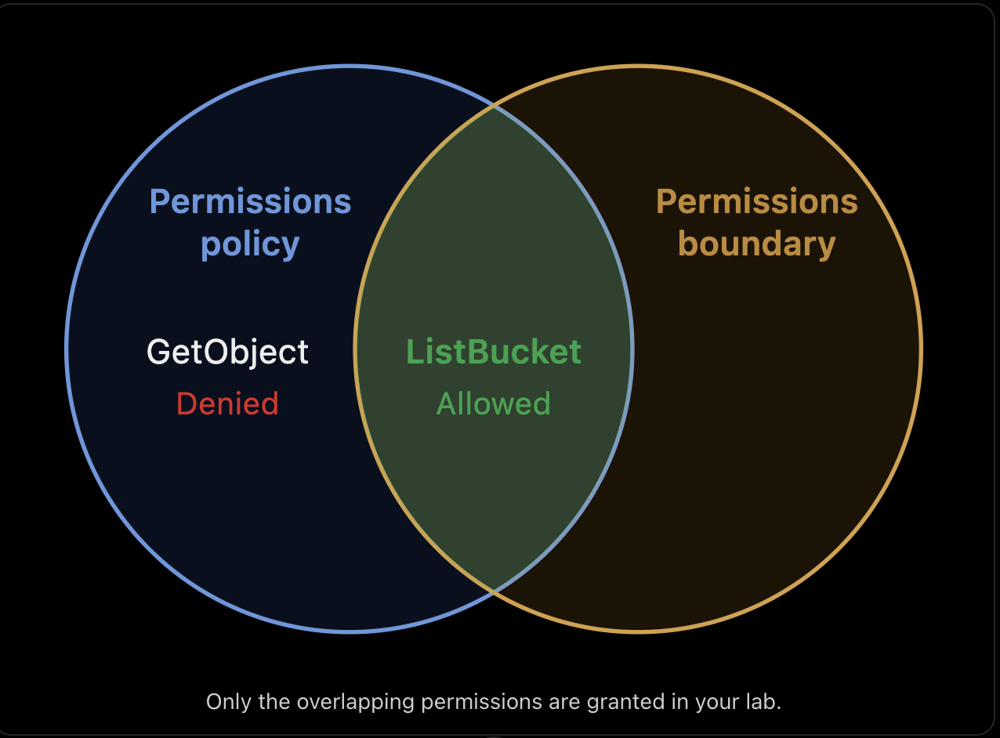

## Evidence

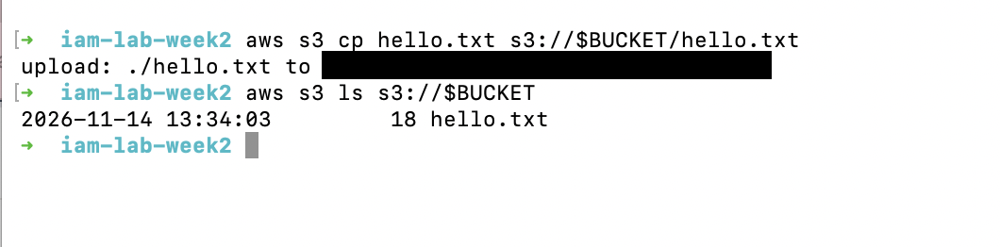
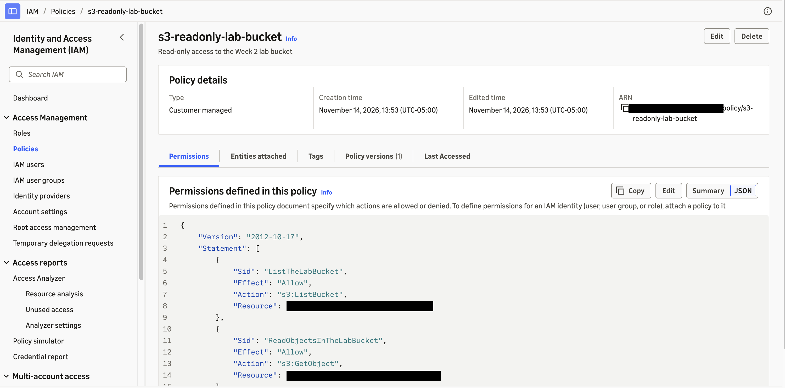
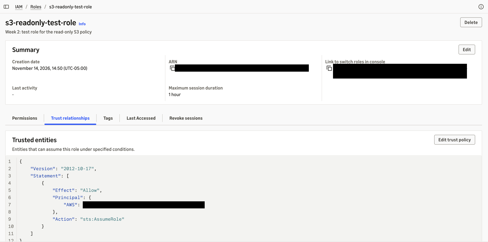
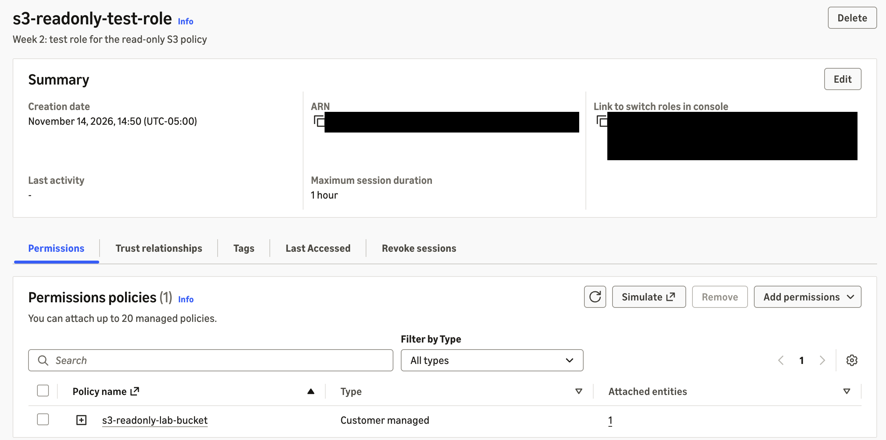
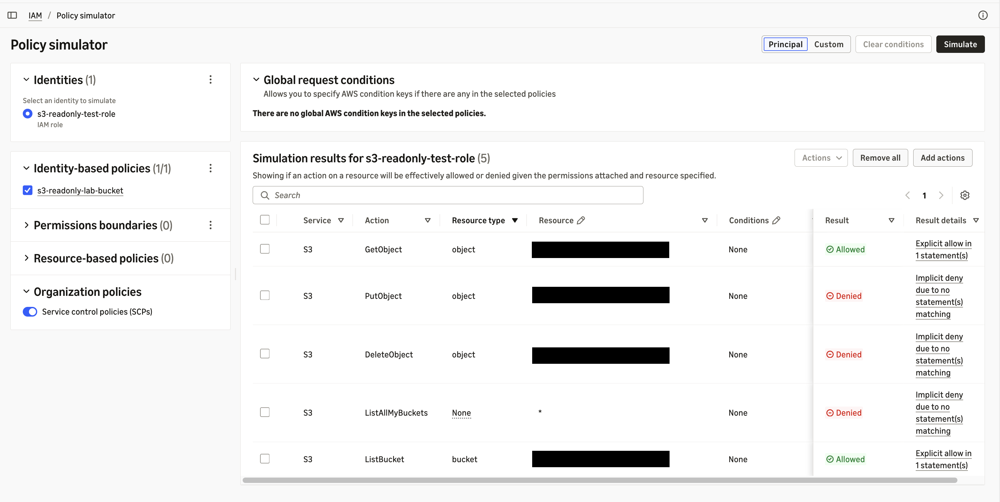
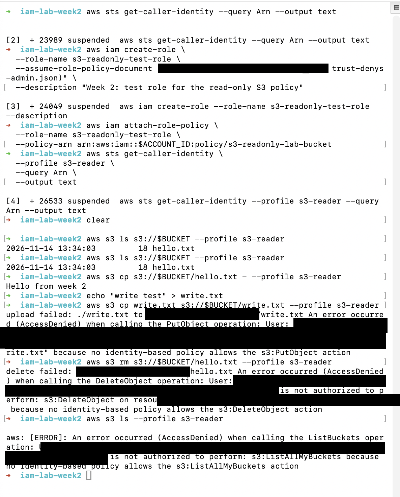
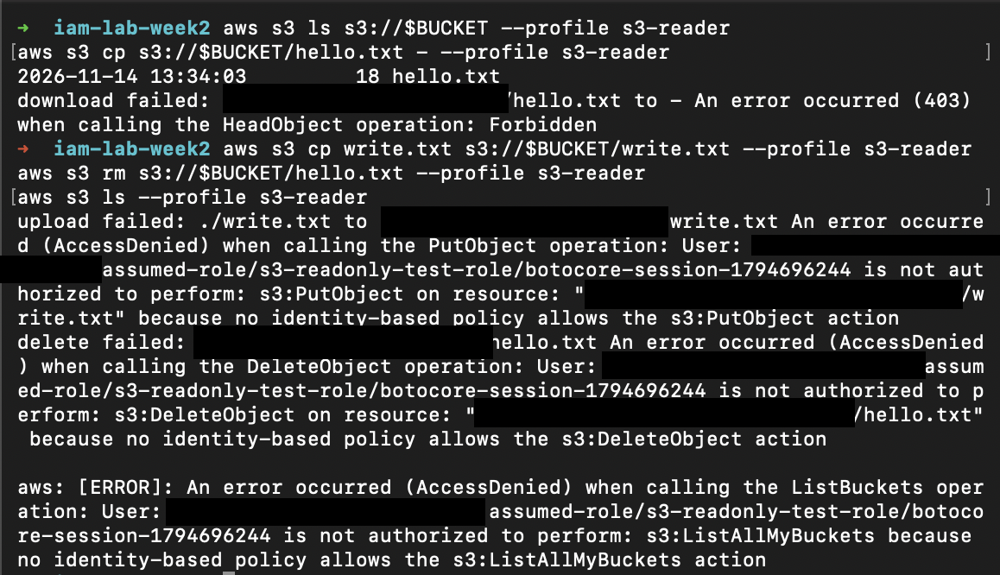
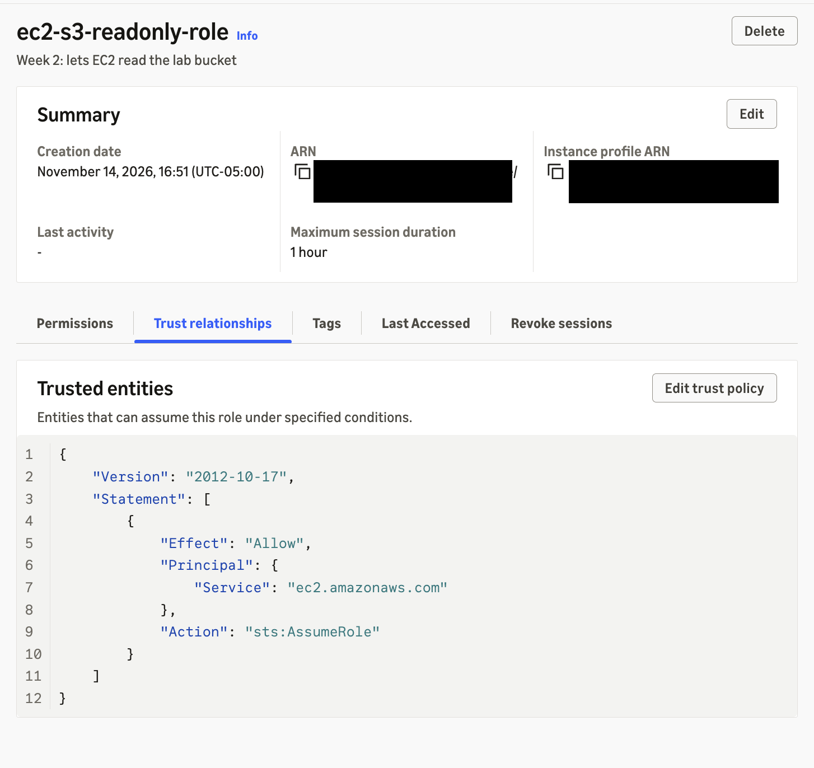
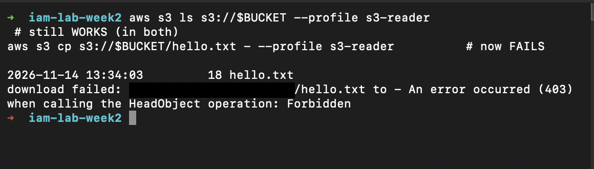

## What surprised me

An IAM role can lose access to a resource without changing its original permissions policy.

The original policy explicitly allowed s3:GetObject, but after applying the permissions boundary, AWS denied the action.

This is surprising because I might initially assume that an Allow in a permissions policy guarantees access. 

This helped me understand that granting a permission does not necessarily guarantee access because AWS evaluates multiple policies to determine effective permissions.


## What I'd do differently in a company account

In a company AWS account, I would implement additional security controls beyond those used in this lab. I would use IAM Access Analyzer to generate least-privilege policies based on actual usage and Service Control Policies (SCPs) to enforce organization-wide security restrictions. I would also implement resource tagging and Attribute-Based Access Control (ABAC) to simplify permission management as the company grows.

Additionally, I would avoid using AdministratorAccess for day-to-day operations and instead rely on least-privilege IAM roles, temporary credentials, MFA, and permissions boundaries. These practices would help reduce security risks, prevent privilege escalation, and minimize the potential damage caused by compromised identities or human error.