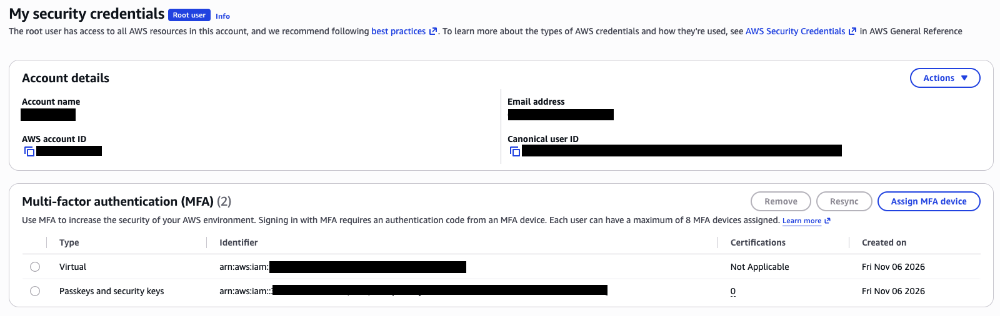
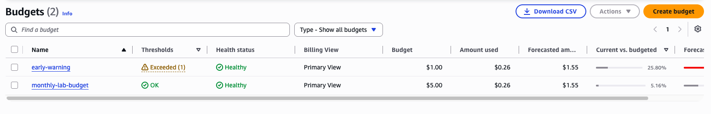
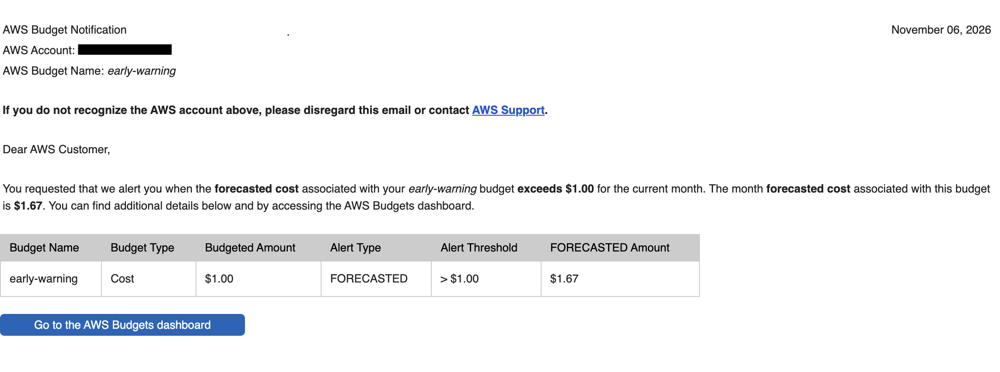
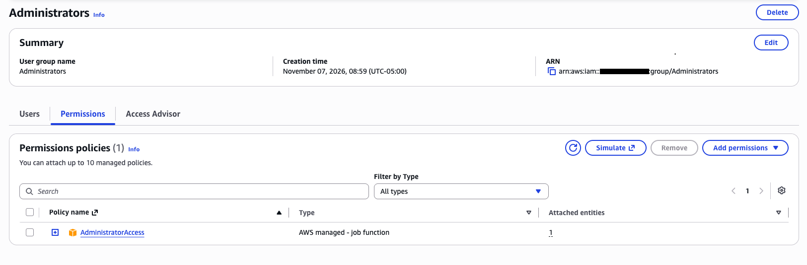
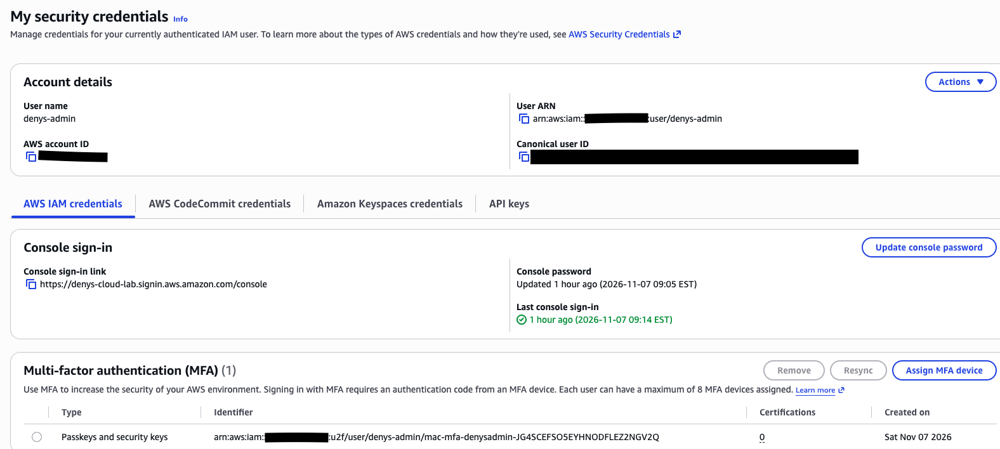
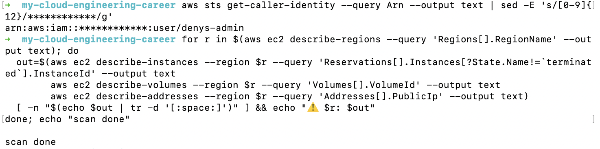
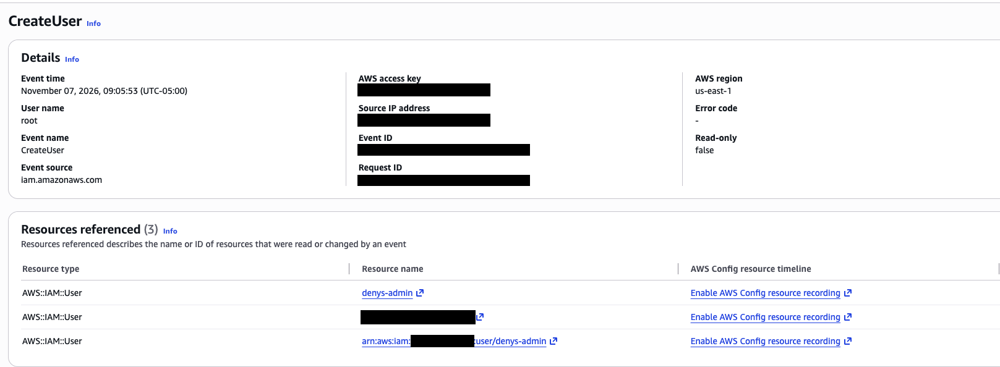
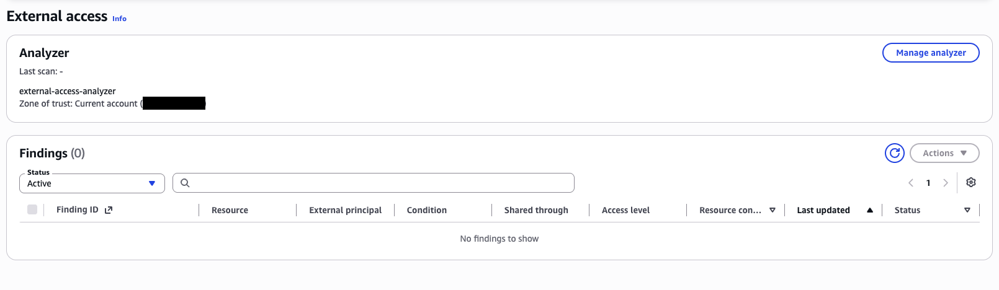

# Securing a New AWS Account

> **Status:** Complete (Week 1).
> **Date:** 2026-11-07 · **Environment:** personal AWS account (Free plan), us-east-1

## Why this matters

Before I turned on MFA, anyone with my root password could get into my AWS account. They could steal or delete data, run costly services, or take over my resources. That’s why I protected the account on day one. MFA keeps strangers out, and a budget alert warns me when spending jumps. Waiting is risky: a break-in and a big bill can happen within hours. Root has full control over everything in the account, including billing, so protecting it early is a must.

## What I configured

| Control                | What I did                                                                                                                                         | Why                                                                      |
| ---------------------- | -------------------------------------------------------------------------------------------------------------------------------------------------- | ------------------------------------------------------------------------ |
| Root MFA               | Two MFA devices on the root user: a passkey and an authenticator app                                                                               | A stolen password alone can't open the one identity that can do anything |
| No root access keys    | Checked Security credentials: the root user has no access keys                                                                                     | Root keys can't be limited, skip MFA and never expire                    |
| Budget alert           | `monthly-lab-budget`: $5 per month, alerts at 85% and 100% of actual spend + forecast. The forecast alert fired on 2026-11-06                | AWS doesn't stop costs on its own; the alert is the early warning        |
| Admin IAM user + group | Group `Administrators` with `AdministratorAccess`. User `denys-admin` in that group, signed in with a passkey MFA. Account alias `denys-cloud-lab` | Daily work without root; permissions live on the group, not the person   |
| CLI authentication     | `aws login --profile lab` with short-term credentials, so no access keys are saved on my laptop. Checked with `aws sts get-caller-identity`        | Temporary credentials instead of permanent keys in a file                |
| Audit check            | CloudTrail Event history shows the `CreateUser` event. IAM Access Analyzer (external access) found 0 findings                                      | Confirms activity is logged and nothing is shared outside the account    |

## Why each control matters

### Root MFA

A new AWS account has one way in: the root user, protected only by an email and a password. Root has full power. It can spend money, delete everything or close the account. So the first thing I did was turn on MFA (multi-factor authentication). It requires a second proof of identity, so a stolen password alone isn't enough to get in.

I registered two devices. The first is a passkey (fingerprint, face scan or security key). It's the safest option because it only works on the real AWS sign-in page, so a fake login page can't trick it. The second is an authenticator app, which I keep as a backup in case the passkey is lost or broken. Without a backup, getting back in means a slow account-recovery process. The two are on separate physical devices.

After setup, I stopped using root for everyday work and use a separate admin user instead. Early habits stick, so starting safe is easier than fixing problems later.

### No root access keys

Access keys are a key ID and a secret that let programs control an AWS account without signing in. On the root user they are especially dangerous. They can do anything and can't be limited, they skip MFA, and they never expire. They also leak easily, into code or public GitHub repos, where attackers scan for them constantly. One leaked root key can mean a huge bill or a wiped account within minutes.

New accounts usually have no root keys, but I checked anyway. I signed in as root, opened Security credentials and confirmed the Access keys list was empty. When a script or tool needs access, it should get its own limited user or role, never root. MFA locks the front door; root access keys would be a back door with no lock.

### Budget alert

A budget is a monthly spending limit I choose. AWS emails me when costs get close to it or go over. This matters because AWS doesn't stop resources on its own: services keep running, and costing money, until someone turns them off. On my Free plan that usage is paid from my credits, so a forgotten resource quietly eats into them. Alerts can also catch a break-in. Attackers with stolen credentials often launch expensive servers, and a sudden spike may be the first sign.

There are two kinds of alert. Actual alerts fire when real spending passes a threshold, such as 50%, 80% or 100%. A forecast alert fires when AWS predicts I'll go over by the end of the month. Either way, an alert only warns. It doesn't stop anything, so I have to act when one arrives.

My forecast alert fired on 2026-11-06. The cause was a test project I'd stopped working on weeks earlier: an EC2 instance was still running, and a daily AWS Backup plan kept creating snapshots of it. The audit section below covers what else I found.

### Admin IAM user + group

Once root was secure, I created a separate admin identity for daily work. First I created a group called `Administrators` with the `AdministratorAccess` policy. Putting permissions on a group instead of a person keeps them tidy: add someone to the group and they get admin rights, remove them and they lose them. Then I created my everyday user, `denys-admin`, in that group.

Why not just use root? Root has powers no policy can limit, like closing the account. If `denys-admin` is ever compromised, root can still fix it; if root is compromised, nothing can. Actions are also logged under a named user, so it's clear who did what. Because this user is powerful too, it's protected with a passkey, so a stolen password isn't enough.

Finally, I set the account alias `denys-cloud-lab`, which replaces the hard-to-remember account ID in my sign-in link. That makes signing in easier and mistakes less likely, but it's only a convenience. It isn't secret and doesn't protect anything. Root is the master key in the safe; `denys-admin` is my everyday key with a strong lock.

### CLI authentication

The old way to use the AWS CLI was to save access keys in a file on the laptop. That's risky. The keys never expire, they sit in plain text that anyone with the laptop could copy, they skip MFA, and they often leak through backups, screenshots or code on GitHub. I found exactly this on my own laptop (see the audit section).

`aws login --profile lab` avoids it. I sign in through the browser as `denys-admin` with my passkey, and the CLI gets temporary credentials that expire on their own. No long-term keys are stored, so stolen credentials soon stop working and a lost laptop is much less dangerous. The `lab` profile is a named setup for this account that keeps it separate from any other, so commands don't run in the wrong place.

After signing in I run `aws sts get-caller-identity`. It shows the account and user I'm signed in as, which confirms I'm `denys-admin` in the right account, not root or someone else, before I change anything or spend money. `aws login` is a temporary visitor pass instead of a permanent key, and `get-caller-identity` is checking the name on the pass.

### Audit check

After setup I checked two things: is AWS recording what happens in my account, and is anything open to outsiders?

First, CloudTrail Event history. CloudTrail is the account's activity log, like a security camera. It records who did what, when and from where. I found the `CreateUser` event from when I created `denys-admin`. If I can see my own actions, logging works, and I'd see anyone else's too. It's also where I'd look if something odd happened, like a surprise bill or a user I don't recognize, so learning where to look now helps in an emergency later. Event history keeps 90 days; for longer, I'd create a trail that saves logs to S3.

Second, IAM Access Analyzer. It scans resources such as S3 buckets, IAM roles and KMS keys for anything reachable from outside my account. Zero findings means nothing is shared with other accounts or the public. That matters because accidentally public buckets are a top cause of cloud data leaks. A clean result is also a baseline: if a finding appears later, something changed.

In short: the camera is recording, and no doors are left open.

## IAM user vs IAM Identity Center: my decision

For personal AWS learning with a single account, an IAM user with multi-factor authentication is sufficient. This simple setup is easy to configure and manage. To handle daily administrative tasks safely, I use my IAM user instead of the root account. I enable multi-factor authentication for extra protection. When managing multiple accounts or business environments, organizations should switch to IAM Identity Center. This service centralizes user access management across an entire enterprise. By offering Single Sign-On capabilities, IAM Identity Center allows employees to access authorized accounts with one sign-in. The system provides temporary credentials rather than long-term access keys. To reduce security risks, administrators can easily grant or revoke access from one central location. IAM Identity Center remains the superior choice for multi-user cloud environments.

## Auditing what was already in the account

I found leftover AWS resources from my old project, "ai-agent-sandbox," after receiving a Budgets forecast alert on November 6, 2026. I thought my AWS account would cost nothing, but an old EC2 instance had been using my credits. After terminating it, I ran a CLI scan and discovered more resources, including AWS backups, an S3 bucket, an SNS topic, a CloudWatch alarm, a VPC, and IAM resources.

I was surprised that AWS backups continued costing money even after I terminated the EC2 instance. I also found an old IAM access key stored on my laptop and a backup from September 10 that would never expire automatically.

The AWS Backup resources would have caused the most financial damage because they could continue generating charges even without a running EC2 instance. The old IAM access key was also a serious security risk because someone who obtained it could potentially access my AWS account.

A review of the IAM policy on `denys-dev`, a user from my old project, showed that the user had more permissions than intended. The policy allowed creating IAM roles, attaching policies, and passing roles without restrictions. This meant the supposedly limited user could create a role, attach AdministratorAccess, pass it to an EC2 instance, and gain administrator privileges.

To fix this, I would require a permissions boundary when creating new roles using `iam:PermissionsBoundary`. I would restrict which policies could be attached using `iam:PolicyARN`. I would also limit `iam:PassRole` to a specific role path and the EC2 service using `iam:PassedToService = ec2.amazonaws.com`.

The policy also allowed `budgets:*`, which meant the user could delete budget alerts. I would replace it with the read-only permission `budgets:ViewBudget`. Finally, I would restrict EC2 permissions based on region, instance type, or resource tags instead of allowing actions on all resources.

Reviewers look for unrestricted `iam:PassRole` because it can create a serious privilege-escalation risk when combined with permissions to create roles, attach powerful policies, and launch services like EC2. A user with limited permissions could pass a more powerful role to an EC2 instance and gain administrator access through that instance. Restricting which roles can be passed and which services can receive them helps prevent this security risk.

I couldn't delete `ai-agent-sandbox-ec2-role` because it was still associated with the instance profile `ai-agent-sandbox-ec2-profile`. The AWS IAM console showed the role but did not provide a clear way to view or manage the instance profile containing it. This visibility limitation made it difficult to understand why the role couldn't be deleted.

I used the AWS CLI to find and remove the dependency. First, I removed the role from the instance profile, then deleted the instance profile, and finally deleted the IAM role.

An instance profile is a container that allows an EC2 instance to use an IAM role and receive temporary AWS credentials. The important lesson was that the console didn't clearly expose the instance profile dependency, even though AWS still enforced it. Using the CLI helped me identify and remove that dependency in the correct order.

## Evidence

## What surprised me

What surprised me most was that a supposedly limited IAM user actually had administrator-level access through a privilege-escalation path. The `denys-dev` policy allowed creating roles, attaching powerful policies, and passing roles to EC2 instances without restrictions. I didn't realize how dangerous these permissions were when combined.

In the future, I'll review IAM policies more carefully, follow the principle of least privilege, and restrict permissions using conditions and permissions boundaries. I'll also audit my AWS account regularly instead of waiting for a budget alert to discover security problems.

## What I'd do differently in a company account

In a company AWS account, I would improve security and cost management by making four changes.

AWS Organizations: I would separate production, development, sandbox, and security environments into different AWS accounts. This would prevent mistakes in one environment from affecting the others.

Service Control Policies (SCPs): I would set security rules across accounts to prevent dangerous actions, such as disabling CloudTrail, leaving the organization, or using unapproved AWS regions.

AWS IAM Identity Center: Instead of creating IAM users with long-term access keys, I would use Identity Center to manage employee access with temporary credentials and permissions based on their job roles.

Infrastructure as Code (Terraform): I would create and remove AWS resources using Terraform. This would make it easier to track resources and clean up entire projects without leaving behind backups, IAM roles, or other resources that could create unexpected costs.

These changes would help make the company's AWS environment more secure, organized, and easier to manage.
