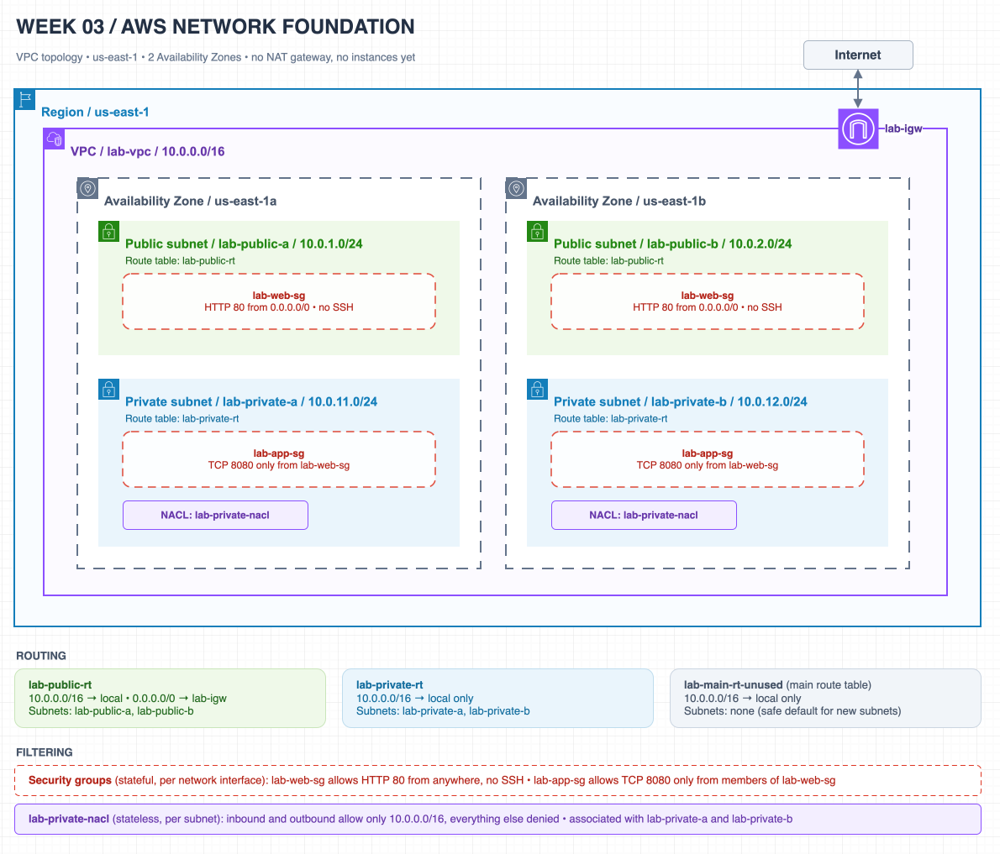
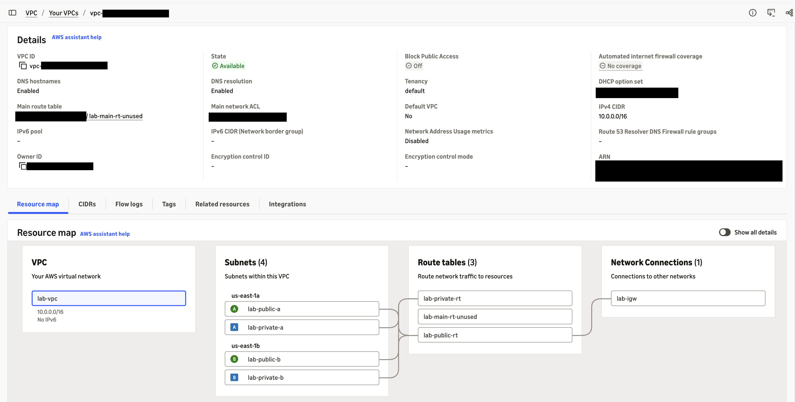
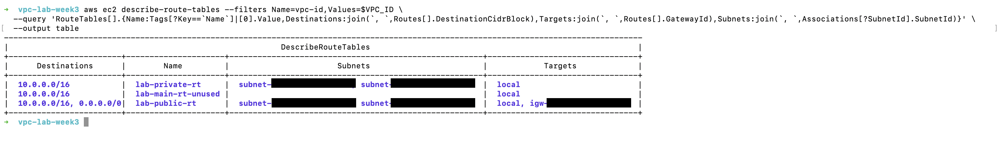
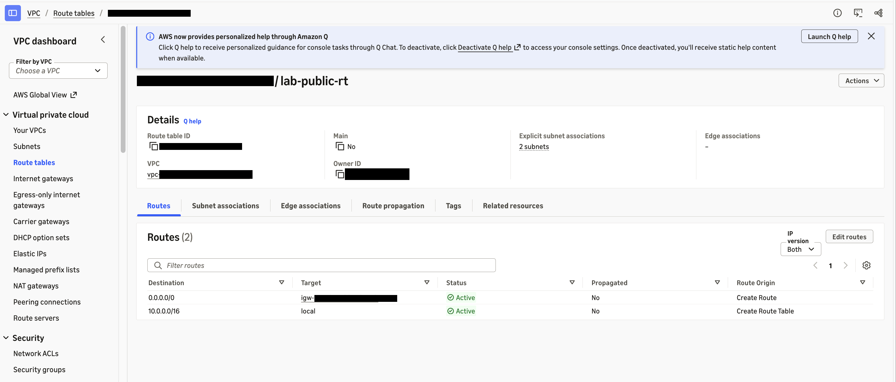
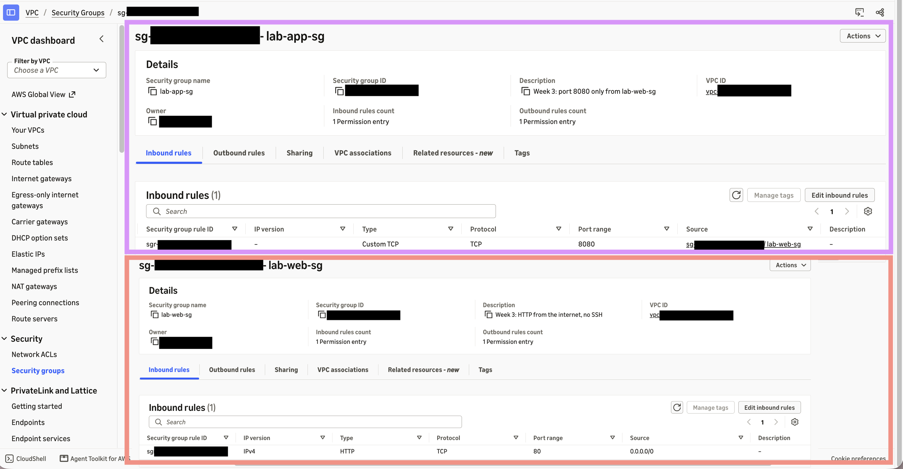
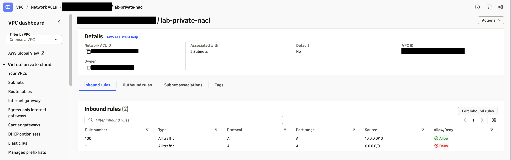

# VPC Networking: Public and Private Subnets Across Two Availability Zones

> **Status:** Complete (Week 3).
> **Date:** 2026-11-21 · **Environment:** personal AWS account (Free plan), us-east-1

## Why this matters

IP address planning: plan a network before deploying resources, because changing an existing network's address structure can be difficult and disruptive. Plan first. Build second.

Every account comes with a default VPC. It is designed to make getting started easy, but it has only public subnets, and in a company you'd never put a database in one. My custom VPC is designed to give intentional control over networking and security.

In a real company, the private subnets hold everything that should never be reached directly from the internet: databases, application servers, internal APIs and batch jobs. Only the load balancer or web tier sits in the public subnets.

## My network design

| Subnet | AZ | CIDR | Usable IPs | Route table | Public? |
| ------ | -- | ---- | ---------- | ----------- | ------- |
| `lab-public-a`  | us-east-1a | 10.0.1.0/24  | 251 | `lab-public-rt`  | Yes |
| `lab-public-b`  | us-east-1b | 10.0.2.0/24  | 251 | `lab-public-rt`  | Yes |
| `lab-private-a` | us-east-1a | 10.0.11.0/24 | 251 | `lab-private-rt` | No  |
| `lab-private-b` | us-east-1b | 10.0.12.0/24 | 251 | `lab-private-rt` | No  |

I built everything from the AWS CLI and saved each resource ID to an `ids.env` file, so I could reload them in a new terminal with `source ids.env`.

**1. How many /24 subnets fit in a /16?**

My VPC has 65,536 addresses. Each /24 subnet has 256. So 65,536 / 256 = **256 possible subnets**.

**2. Which 5 addresses does AWS reserve in a subnet, and what is each one for?**

AWS reserves the first four and the last IPv4 address in each subnet, because it needs them for its own networking. For my 10.0.1.0/24 subnet:

- `10.0.1.0`: identifies the network itself
- `10.0.1.1`: the VPC router
- `10.0.1.2`: reserved for DNS
- `10.0.1.3`: reserved for future AWS use
- `10.0.1.255`: broadcast address (reserved, AWS doesn't support broadcast)

This leaves 251 usable IP addresses per subnet.

**3. Why leave gaps between the public and private ranges?**

Leaving gaps makes the network easier to organize and expand, for example when a company grows and needs more public subnets, private subnets or dedicated database subnets. We could follow an address convention like this:

| IP range pattern | Intended purpose |
| ---------------- | ---------------- |
| 10.0.1.x – 10.0.9.x   | Public subnets |
| 10.0.11.x – 10.0.19.x | Private application subnets |
| 10.0.21.x – 10.0.29.x | Future database subnets |
| 10.0.31.x – 10.0.39.x | Future internal services |

This is an example naming and addressing convention, not an AWS requirement. The route table still determines whether a subnet is public or private.

AWS also recommends leaving unused address space for future expansion ([Well-Architected: IP subnet allocation](https://docs.aws.amazon.com/wellarchitected/2025-02-25/framework/rel_planning_network_topology_ip_subnet_allocation.html)). It matters for organization, scalability, easier troubleshooting and future expansion.

## What makes a subnet public

There is no "public" checkbox on a subnet. A subnet is public only because its route table has a route that sends `0.0.0.0/0` (all non-local traffic) to an internet gateway. `lab-public-rt` has that route to `lab-igw`; `lab-private-rt` only has the `local` route for 10.0.0.0/16, so its subnets can talk inside the VPC but not to the internet.

A public subnet alone doesn't expose anything. For an instance to be reachable from the internet it also needs a public IP address and a security group that allows the traffic. This week I built the route; Week 4 adds the instance and its public IP.

If a fifth subnet is created without an explicit route table association, it automatically uses the VPC's main route table. Since the main route table (`lab-main-rt-unused`) contains only the local route and no route to the internet gateway, the new subnet remains private. This is a safe default because it prevents accidental exposure of resources to the internet and requires an intentional configuration to make a subnet public. This security principle is called secure by default.

## Security groups vs network ACLs

| | Security group | Network ACL |
| - | -------------- | ----------- |
| Applies to | Network interfaces (e.g. EC2 instances) | Entire subnet |
| Stateful or stateless | Stateful: automatically allows response traffic | Stateless: requires rules for both directions |
| Allow / deny rules | Allow rules only (implicit deny) | Both allow and deny rules |
| Rule evaluation | Evaluates all rules; traffic is allowed if any rule matches | Evaluates rules in numerical order, lowest first; first match wins |

What I built:

- `lab-web-sg`: HTTP 80 from anywhere (0.0.0.0/0), no SSH.
- `lab-app-sg`: TCP 8080 only from `lab-web-sg`.
- `lab-private-nacl` on both private subnets: inbound and outbound rule 100 allows all traffic for 10.0.0.0/16; the default `*` rule denies everything else.

**Why is using lab-web-sg as a source better than using 10.0.1.0/24?**

Referencing a security group allows authorized web servers to communicate with the application server regardless of changes to their private IP addresses or subnet placement within the VPC. It also prevents unrelated resources in the same subnet from automatically receiving access. This improves security, scalability and maintainability.

**Can a security group rule explicitly deny a specific IP address? Why not?**

No. AWS security groups support only allow rules. Traffic that does not match an allow rule is implicitly denied. Network ACLs can be used when explicit deny rules are required.

**Why did I need an outbound rule for the NACL when security groups didn't need one for replies?**

Network ACLs are stateless, meaning they do not remember established connections. Incoming and outgoing traffic must be allowed separately. Security groups are stateful and automatically allow response traffic for permitted connections.

**If inbound traffic is restricted to TCP port 8080 from 10.0.1.0/24, which outbound rule would you need?**

When a client opens a connection, its operating system picks a temporary source port, called an ephemeral port (somewhere in 1024–65535). The server's reply goes back to that port, so a stateless NACL has to allow it outbound:

- Rule number: 100
- Protocol: TCP
- Destination: 10.0.1.0/24
- Destination port range: 1024–65535
- Action: Allow

This rule allows the application server to send responses back to the ephemeral ports used by the web server.

**What additional protection does the NACL provide if the private route table already has no internet route?**

The NACL adds an independent layer of network security by restricting inbound and outbound traffic to the VPC's CIDR range. Even if someone accidentally adds an internet route to the private route table, the NACL continues to block traffic to and from external IP addresses. This is an example of defense in depth.

## Why there's no NAT gateway

A NAT gateway sits in a public subnet and lets instances in private subnets start connections to the internet (for example, to download updates), while nothing on the internet can start a connection to them.

It is not free: in us-east-1 it costs about $0.045 per hour plus $0.045 per GB processed, which is roughly **$32 per month even when idle**, and it also uses a public IPv4 address. My private subnets have nothing in them yet, so there is nothing that needs outbound internet access, and I left it out to keep the lab at $0.

Ways a private subnet can reach AWS services without a NAT gateway:

- **Gateway VPC endpoints** for S3 and DynamoDB: free, added as a route in the private route table.
- **Interface VPC endpoints** (PrivateLink) for services like Systems Manager or CloudWatch: charged per hour, but traffic stays on the AWS network.

## Evidence

## What surprised me

There is no "public" setting on a subnet. The only difference between `lab-public-a` and `lab-private-a` is one route in the route table they are associated with. The VPC resource map made this easy to see: the subnets, route tables and internet gateway are drawn as separate boxes connected by lines.

## What I'd do differently in a company account

- Plan the CIDR with the network team first, so it doesn't overlap with on-premises networks or other VPCs that may need peering or a VPN later.
- Use three Availability Zones for production, and add dedicated database subnets.
- Add NAT gateways (one per AZ) or VPC endpoints when private workloads need outbound access.
- Turn on VPC Flow Logs to record accepted and rejected traffic.
- Build it with infrastructure as code (Terraform or CloudFormation) instead of one-off CLI commands, so it can be reviewed and rebuilt.

## Quick reference

| AWS concept | Remember it as |
| ----------- | -------------- |
| VPC | Private neighborhood |
| CIDR block | Available addresses |
| Availability Zone | Physical location |
| Subnet | Section of the neighborhood |
| Internet gateway | Main entrance |
| Route table | Road directions |
| Main route table | Default directions |
| Security group | House security guard |
| Network ACL | Neighborhood checkpoint |
| Stateful | Remembers |
| Stateless | Doesn't remember |
| NAT gateway | Exit-only gate for new connections |

Three questions to troubleshoot any resource:

- Where does my resource live? VPC and subnet.
- Where can its traffic go? Route table and gateways.
- What traffic is allowed? Security groups and NACLs.

| Question | Answer |
| -------- | ------ |
| What makes a subnet public? | A route to an internet gateway. |
| Can multiple subnets share a route table? | Yes. |
| Can a subnet use two route tables simultaneously? | No. |
| What happens without an explicit association? | The subnet uses the main route table. |
| Can public and private subnets communicate? | Yes, if routing and security rules permit it. |
| Does a public subnet automatically expose an EC2 instance? | No. It also needs a public IP for direct IPv4 access and appropriate firewall rules. |

Security principles I applied:

- **Least privilege:** only allow necessary traffic.
- **Reduce attack surface:** keep unnecessary ports closed (no SSH).
- **Network isolation:** protect backend services from public access.
- **Scalability:** reference security groups instead of hardcoding IP addresses.
- **Implicit deny:** block traffic unless it is explicitly permitted.

Skills I practiced building it from the CLI:

| Skill | Why it matters |
| ----- | -------------- |
| AWS CLI | Create infrastructure with commands instead of clicking through the console |
| Bash variables and shell functions | Automate and reuse repetitive commands |
| Persistent variables (`ids.env`) | Keep resource IDs across terminal sessions |
| Resource tagging | Organize cloud infrastructure |
| DNS configuration | Enable name-based networking inside the VPC |
| Network segmentation and multi-AZ design | Separate resource types and prepare for an AZ failure |
| Resource verification | Confirm the infrastructure is configured correctly |

| Variable type | Example | What happens when I close the terminal? |
| ------------- | ------- | --------------------------------------- |
| Shell variable | `VPC_ID=...` | Disappears with that shell session |
| Saved configuration file | `ids.env` | Stays on my computer |
